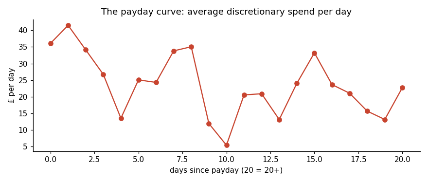
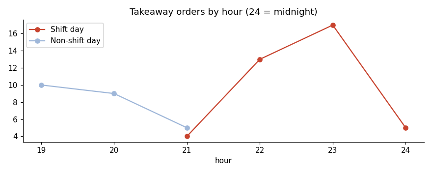

# The Real Price
### What my spending cost in hours of my life: a *Spending Wrapped* story

> **Simulated data.** The transactions are simulated, modelled on my real lifestyle in 2026 (a data internship with office days in Milton Keynes, weekend retail shifts, then full-time retail). The method, code and analysis are real. A version on my real, anonymised bank data is kept private.

**Business question:** where does my money go, when and why do I overspend, how does the way I pay change what I spend, and what should I change?

**Result:** £18,246 spent in 10 months, equal to 1,436 hours of work. £1,453 (8%) was leakage, and five simple rules would save £1,665 a year (131 hours) and make my savings last about two months longer.

**Stack:** Python (pandas, NumPy, Matplotlib), SQL (SQLite, 10 queries), Jupyter, Excel (openpyxl what-if model), HTML/JavaScript dashboard.

Every result is also shown in **hours of work** (£ ÷ £12.71 per hour, the UK National Living Wage from April 2026), because "£900" is easy to ignore and "71 hours of shifts" is not.



## Headline findings (1 Jan to 25 Oct 2026, 707 transactions)

| | Finding |
|---|---|
| **Total** | £18,246 spent = **1,436 hours of work** (about 191 shifts) |
| **Leakage** | £1,453 (8%) was money lost without value: late shift-day takeaways, unused subscriptions, in-store protein tubs, untracked cash |
| **Payday effect** | In the 3 days after payday I spent **1.6× more per day** (£34.90 vs £21.53); a permutation test puts the chance of this being luck at 0.08% |
| **Late-night tax** | £1,672 of discretionary spending happened between 22:00 and 05:00 = **132 hours** |
| **After-shift takeaways** | All **39** takeaways ordered on shift days came after 21:00: £903 = **71 hours**. I worked 9.5 shifts to pay for being too tired to cook |
| **Top-up premium** | A third of grocery money (£879, 81 trips) went on small convenience top-ups |
| **Lifestyle stickiness** | When the internship ended, income per day fell **45%** but spending per day fell only **22%** |
| **The plan** | 5 rules save **£1,665 a year (131 hours)** and push the date my savings run out from **15 Mar 2027 to 21 May 2027** |



More charts are in [`images/`](images/). Full write-up: [`docs/findings.md`](docs/findings.md).

## See it

- **Interactive dashboard:** [`dashboard/the_real_price_interactive.html`](dashboard/the_real_price_interactive.html). Switch every number between £, hours of work and shifts; filter by period, shift days and spend type; click any day of the year; rewrite the ending with what-if sliders. Download the file and open it in a browser.
- **Spending Wrapped story:** [`dashboard/spending_wrapped.html`](dashboard/spending_wrapped.html)
- **What-if simulator:** [`docs/what_if_simulator.xlsx`](docs/what_if_simulator.xlsx). Change the assumptions and see the savings.

## How it works

```
data/raw (simulated bank statement)
   └─ scripts/enrich.py ──► data/processed/transactions_enriched.csv   (weekday, hour, time band, shift day,
                                                                         days since payday, spend type, hours of work)
        ├─ sql/01–10 (SQLite) ──► sql/results/*.csv                     (WHAT / WHEN / WHY / HOW / SOLUTION)
        ├─ notebooks/01_analysis.ipynb ──► images/*.png, metrics.json  (payday test, protein economics,
        │                                                                 hours of life, 5-rule plan, savings runway)
        ├─ scripts/build_wrapped.py ──► dashboard/spending_wrapped.html
        ├─ scripts/build_interactive.py ──► dashboard/the_real_price_interactive.html
        └─ scripts/build_what_if.py ──► docs/what_if_simulator.xlsx
```

## Run it yourself

```bash
pip install -r requirements.txt
python3 scripts/enrich.py                       # raw -> processed
sqlite3 spending.db < sql/00_load.sql           # load into SQLite
sqlite3 -header -column spending.db < sql/06_why_payday_effect.sql
jupyter nbconvert --to notebook --execute --inplace notebooks/01_analysis.ipynb
python3 scripts/build_wrapped.py
python3 scripts/build_interactive.py
python3 scripts/build_what_if.py
```

Requires Python 3 and SQLite (built into macOS).

## Repository

| Folder | Contents |
|---|---|
| `data/raw/` | Simulated statement and the script that generated it (seeded, reproducible) |
| `data/reference/` | `spend_type_map.csv`: my rules for Essential / Investment / Lifestyle / Leakage |
| `data/processed/` | Enriched data used by every step |
| `sql/` | 10 commented queries, one per question, and their results |
| `notebooks/` | The analysis notebook |
| `dashboard/` | Spending Wrapped page, interactive dashboard and `metrics.json` |
| `docs/` | Data dictionary, findings, what-if simulator |
| `images/` | Charts |

## Data and licence

The data is simulated: I generated it with [`data/raw/generate_simulated_data.py`](data/raw/generate_simulated_data.py) (seeded, so it is reproducible). It contains no real bank data or personal information, so there is no third-party licence to note.

## Limitations

Simulated data; one person; about 10 months with a partial October (handled with per-day figures). Spend types are my own definitions. Protein and top-up savings use stated assumptions; my UK Basket Index project will replace the top-up assumption with real supermarket prices. The payday effect is an association, not proof of cause.

*Praneet Sivakumar · [praneetsivakumar.com](https://www.praneetsivakumar.com)*
