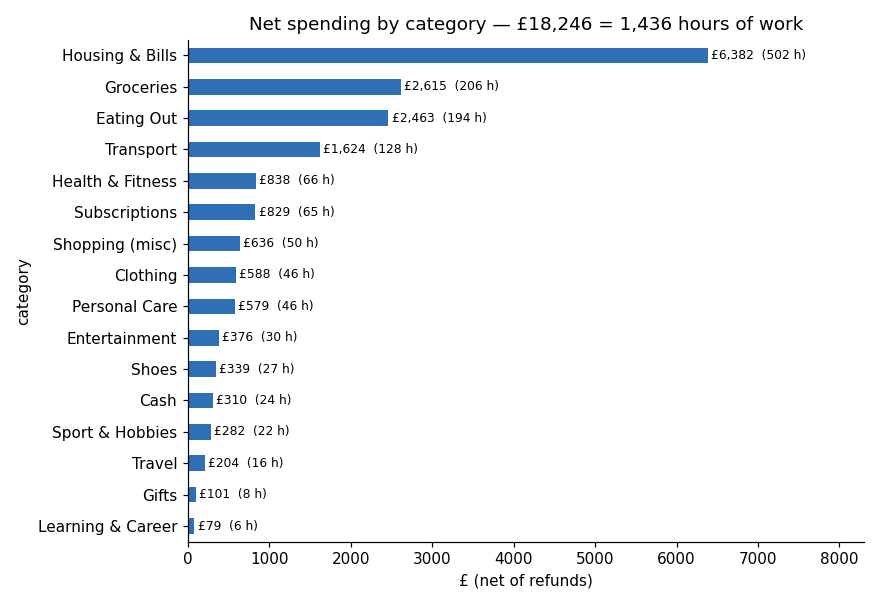
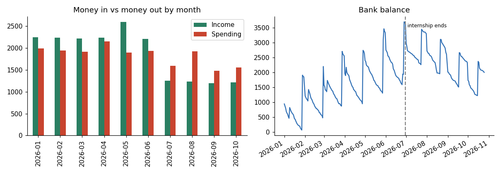
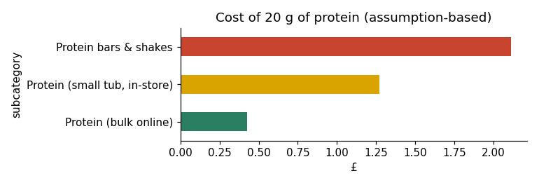

# Findings — The Real Price
*1 Jan – 25 Oct 2026 · 707 simulated transactions · £12.71 = 1 hour of work*

## 1. WHAT — where the money goes
- **£18,246 spent = 1,436 hours of work** (about 191 shifts of 7.5 hours).
- Rent and bills took 35% (£6,382). After that: groceries £2,615 (206 h), **eating out £2,463 (194 h)** — almost as much as groceries — and transport £1,624 (128 h).
- **Top merchant: Trainline** (50 journeys, £1,465) — the cost of the internship commute.
- Spending personality: **Essential 52% · Lifestyle 36% · Leakage 8% (£1,453) · Investment 4% (£757)**.
  

## 2. WHEN — timing
- **Most expensive hour: 20:00.** Evenings (17–22) carry the most discretionary spend (£3,219).
- **Late-night tax:** £1,672 of discretionary spending happened between 22:00 and 05:00 = **132 hours**.
- **Saturday and Friday** are the most expensive days.
- **The internship cliff:** income per day fell **45%** after June; spending per day (excluding rent) fell only **22%**. The balance peaked at £3,694 on 28 June and was £2,000 on 25 October.
  

## 3. WHY — triggers
- **Payday:** in the 0–3 days after payday, discretionary spend averaged **£34.90/day vs £21.53/day** otherwise (**1.6×**). Permutation test (10,000 shuffles): p = 0.0008, so very unlikely to be chance. *Association, not proof of cause.*
  
- **Tiredness after shifts:** 39 of 63 takeaways were on shift days — and **every one of the 39 was ordered after 21:00**. Cost: £903 = **71 hours of work (9.5 shifts)**.
  

## 4. HOW — the way I pay
- **Apple Pay = 64%** of discretionary spending, with a small average (£12.60) — frictionless, frequent and easy to forget.
- **Top-ups:** 81 convenience trips (avg £10.86) took **34% of grocery money** (£879 = 69 hours).
- **Late-night online/app shopping:** £1,587; £157 of ASOS orders came back as refunds — a sign of impulse buying.

## 5. Creative layer
- **Protein economics** (assumption-based): 20 g of protein costs **£0.42 in bulk online, £1.27 from an in-store tub (3× more) and £2.11 from bars**.
  
- **Hours of life:** late-night spending 132 h · after-shift takeaways 71 h · top-ups 69 h · subscriptions 65 h.

## 6. SOLUTION — five rules
| Rule | By 31 Dec | Per year | Hours / year |
|---|---|---|---|
| Cancel zombie & duplicate subscriptions (Disney+, Google One) | £18 | £96 | 8 |
| Shift-day meal prep: replace 3 in 4 late takeaways with a £3 prepared meal | £184 | £1,003 | 79 |
| Halve top-up trips; buy in the weekly shop (assume 25% cheaper) | £27 | £146 | 11 |
| Protein: bulk only | £24 | £131 | 10 |
| 24-hour basket rule for late-night online shopping (assume half never bought) | £53 | £289 | 23 |
| **Total** | **£306** | **£1,665** | **131** |

**Savings runway:** at the post-internship rate (−£14.13/day) the balance reaches £0 around **15 Mar 2027**; with the plan, around **21 May 2027** — 67 extra days. The plan buys time; **only new income (the job search) fixes it.**

Play with the assumptions in [`what_if_simulator.xlsx`](what_if_simulator.xlsx).

## Limitations
Simulated data · one person · partial October · spend types are my definitions · protein/top-up savings use stated assumptions · payday effect = association.
